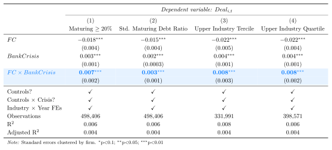
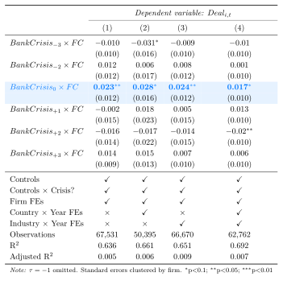
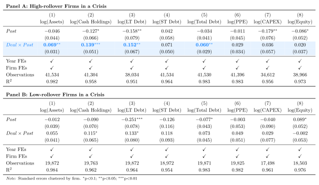
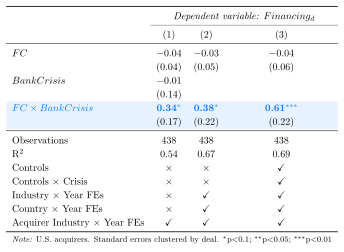
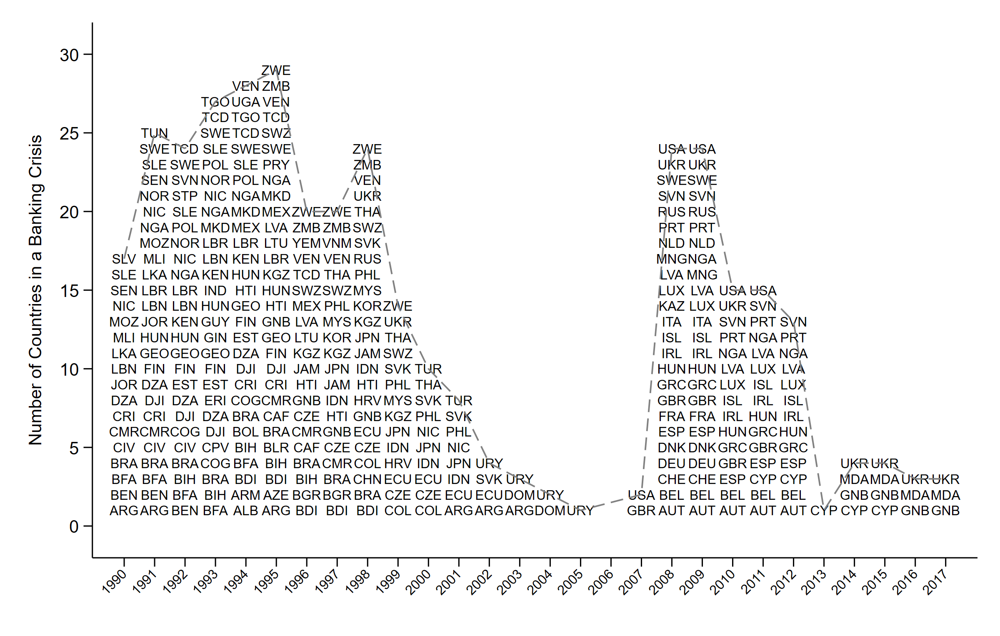
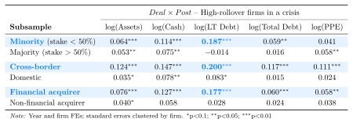
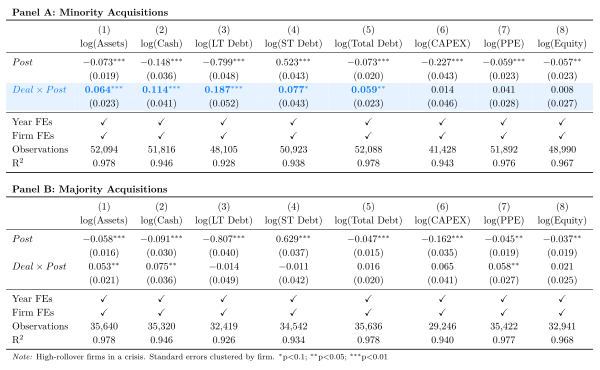
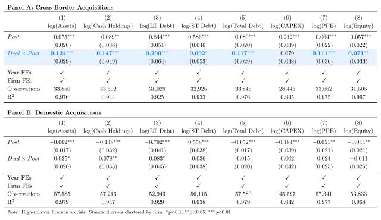
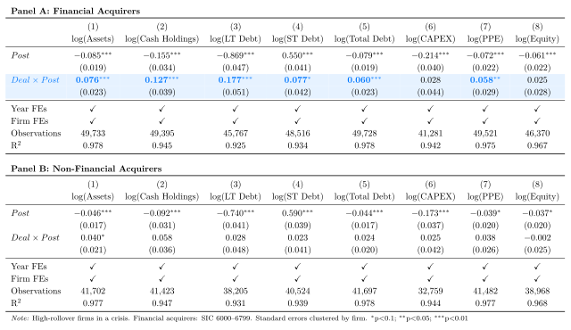

## Banking Crises and the Rollover Problem

-   When a banking system is distressed, the cost of external funding rises for firms that must refinance in the near term -- *i.e.,* the [*credit supply channel*]{.blue} (**Holmstrom & Tirole, 1997; Bernanke & Gertler, 1989**)

-   For many otherwise viable firms, the binding friction is *not* the absence of investment opportunities, but a lack of [*rollover capacity*]{.blue}: maturing obligations must be refinanced precisely when domestic intermediaries and local capital markets are distressed

. . .

**What do we know?**

1.  Credit contractions depress corporate investment (**Duchin, Ozbas, & Sensoy, 2010**)
2.  ...particularly for firms whose long-term debt matures during the shock (**Almeida, Campello, Laranjeira, & Weisbenner, 2012**)

. . .

$\rightarrow$ We understand the *real effects* of credit contractions, but less about the [**organizational mechanisms**]{.blue} through which firms restore funding when domestic refinancing capacity collapses

## This paper

. . .

::: callout-important
## Research Question

Can M&A transactions act as a *financing bridge* that restores debt capacity for viable firms when domestic intermediation contracts?
:::

. . .

**The idea:** in a crisis, an acquirer with continued access to liquidity can target economically viable but financially constrained firms whose domestic refinancing options have deteriorated

-   For the target, the deal need not reflect weak fundamentals, operating synergies, or a desire to transfer control
-   Instead, it links the firm to an entity with stronger funding relationships and access to [*external debt markets*]{.blue}
-   When the acquirer is foreign or internationally connected, the deal can also ease access to deep foreign markets through [*bonding/certification*]{.blue} channels (**Burns, Francis, & Hasan, 2007**)

. . .

$\rightarrow$ [*"Credit crisis acquisitions"*]{.blue}: transactions driven by rollover pressure rather than weak fundamentals, functioning as a bridge to debt capacity

## Our Study

-   **What:** we examine whether M&A transactions reallocate financing capacity to firms with acute refinancing needs when domestic credit supply contracts

-   **How**: use systemic banking crises (Laeven & Valencia, 2018) as negative credit-supply and predetermined *rollover exposure* (Almeida et al., 2012) in a *difference-in-differences* design, linking security-level issuance data and post-deal disclosures

. . .

**Main findings**

1.  High-rollover firms are [14%]{.blue} more likely to become targets in crisis years -- concentrated at crisis onset, with no pre-trends
2.  They also increase assets ([7%]{.blue}), cash ([14%]{.blue}), and long-term debt ([15%]{.blue}) post-deal, with no change in equity; effects concentrated in minority, cross-border, and financial-acquirer deals
3.  Issuance is debt-driven ([+25%]{.blue} debt issuance) and expands into deeper *foreign* markets
4.  Acquirer disclosures explicitly cite financing support for crisis-period, high-rollover targets

## Related Literature

**Credit supply shocks and their spillovers to the real economy:**

1.  Investment and real activity (Duchin et al., 2010; Almeida et al., 2012)
2.  Firm valuations and stock prices (Carvalho, 2015; Tong & Wei, 2011)
3.  Corporate payouts (Bliss, Cheng, & Denis, 2015)
4.  Alternative financing, *e.g.,* trade credit (Garcia-Appendini & Montoriol-Garriga, 2013)

. . .

**M&A and financial constraints:**

1.  Ownership links reduce information asymmetries (Wruck, 1989; Hertzel & Smith, 1993)
2.  Acquisitions alleviate target constraints via cash and investment policies (Erel, Jang, & Weisbach, 2015)
3.  Minority block acquisitions and certification, with an *equity* issuance response (Liao, 2014)
4.  M&A as a tool for *constrained acquirers* to unlock financial synergies (Williamson & Yang, 2021)

## Our Contribution

We differ from existing studies on the financial motives for M&A in three respects:

. . .

1.  [**The friction we isolate:**]{.blue} interacting systemic banking crises with *predetermined rollover exposure* isolates firms facing a sudden loss of domestic refinancing capacity -- rather than generic financial constraints **(Erel et al., 2015)**

2.  [**The geography of relief:**]{.blue} we trace *where* post-crisis borrowing occurs -- additional debt capacity comes from deep *foreign* debt markets, distinguishing our mechanism from an internal-capital-market story

3.  [**The financing margin:**]{.blue} a *debt-centered* mechanism -- high-rollover targets raise debt, not equity, after crisis onset **(Liao, 2014)**

. . .

$\rightarrow$ **Most of this evidence is built around specific episodes (*e.g.,* 2007--2008), and offers less direct evidence on the mechanisms firms use to offset binding refinancing needs**

## Data & Sample

1.  [*SDC Platinum (Refinitiv)*]{.blue}: completed M&A deals (1990--2019) + global debt and equity issuance data
2.  [*Compustat North America/Global*]{.blue}: firm-level financials of targets and non-targets
3.  [*Laeven & Valencia (2018) Systemic Banking Crises Database*]{.blue} + World Bank GFDD: country-year level

-   Targets are combined with all non-acquired Compustat firms $\rightarrow$ unbalanced panel with [**961,909**]{.blue} firm-year observations coming from [58,814]{.blue} unique deals

-   Continuous variables winsorized by year at the $1^{\text{st}}$ and $99^{\text{th}}$ percentiles

## Credit Supply Shock

-   As in **Laeven & Valencia (2018)**, we define [$BankCrisis_{m,t}$]{.blue} as a dummy variable that assigns **1** if firm [$i$]{.blue} is headquartered in a country [$m$]{.blue} that experiences a systemic banking crisis in year [$t$]{.blue}:

    1.  Significant signs of financial distress in the banking system (bank runs, losses in the banking system, and/or bank liquidations); and
    2.  Sign. banking policy intervention measures in response to losses in the banking system

. . .

-   The first year that both criteria are met is the year when the crisis becomes systemic $\rightarrow$ [$BankCrisis_{m,t}=1$]{.blue}

-   The end of a crisis is the year before both real GDP growth and real credit growth are positive for at least two consecutive years $\rightarrow$ [$BankCrisis_{m,t}=0$]{.blue}

. . .

::: callout-note
## Assumption

Banking crises are *supply-side* shocks that tighten domestic credit at short horizons, and are not proxying for decreases in firms' unobserved investment opportunities.
:::

## Exposure to Liquidity Shock: Rollover Pressure

-   We follow **Almeida et al., 2012** and define our measure of rollover exposure based on the portion of long-term interest-bearing debt due in one year. Define $Maturing_{i,t}$ as:

. . .

$$
\small Maturing_{i,t} = \frac{\text{Long-term debt maturing within one year}_{i,t}}{\text{Total long-term debt}_{i,t}}
$$

-   When $\small Maturing_{i,t}$ is above the Fama--French 48 *industry-year* median $\rightarrow$ [$FC_{i,t}=1$]{.blue}

-   [**Intuition**]{.blue}: maturities are hard to adjust in the short run -- the measure captures refinancing needs set *before* the shock, which become salient when domestic credit supply contracts

-   [**Robustness**]{.blue}: fixed threshold ($\small Maturing \geq 20\%$), standardized continuous measure, upper industry tercile, and upper industry quartile

## Empirical Design

-   To examine whether high-rollover firms are more likely to become targets when their headquarters country is hit by a banking crisis, we run:

. . .

$$
\begin{aligned}
Deal_{i,t} = \; & \beta_1\times FC_{i,t} + \beta_2\times BankCrisis_{m,t} + {\color{#42affa}\beta_{DD}}\times (BankCrisis_{m,t}\times FC_{i,t}) \\
& + \gamma_1'Controls_{i,t-1} + \gamma_2'(Controls_{i,t-1}\times BankCrisis_{m,t}) + FEs + \varepsilon_{i,t}
\end{aligned}
$$

-   [**Controls**]{.blue}: 1-year lagged *Cash Holdings*, *Cash Flow*, *Leverage*, and *PPE* (all scaled by *Total Assets*), *Size* (log assets), and *Sales Growth*

-   [**Fixed effects**]{.blue}: firm + industry $\times$ year + country $\times$ year

    -   Country $\times$ year FEs absorb the crisis itself, as well as country-level demand shocks in general (macro conditions, local M&A waves, policy interventions, etc)

    -   $\beta_{DD}$ captures differential targeting of high-rollover firms *within the same crisis environment*

. . .

$\rightarrow$ Under a refinancing-risk mechanism: [$\beta_{DD}>0$]{.blue}

## Testable Predictions

If credit crisis acquisitions substitute for impaired domestic intermediation:

1.  [**Who gets targeted?**]{.blue} The likelihood of being targeted should spike *precisely at crisis onset* for firms with high predetermined refinancing pressure

2.  [**State- and firm-contingent effects:**]{.blue} post-deal effects should be concentrated among crisis-exposed, *high-rollover* targets -- not a generic synergy story

3.  [**Financing margin:**]{.blue} relief should show up in the ability to sustain/raise *long-maturity debt*, with no commensurate increase in equity

4.  [**Geography of capital raising:**]{.blue} targets should expand issuance beyond disrupted domestic markets and into *deeper, more liquid foreign markets*

## #1: High-rollover firms are more likely to become targets during banking crises

{fig-align="center" height="700px"}

-   $0.005/0.036 \approx$ [**14%**]{.blue} higher acquisition likelihood in crisis years (unconditional rate: 3.6%); $FC$ alone has no bite in normal times

## #2: Effects are robust to alternative measures of exposure

{fig-align="center" height="700px"}

## #3: Deal likelihood spikes at the onset of the crisis

{fig-align="center" height="790px"}

## Assessing *ex-post* effects

-   **Do acquisitions relax financing frictions?** We compare the post-deal trajectory of crisis-year targets *vs.* non-targets, separately for [**high-**]{.blue} and [**low-rollover**]{.blue} firms:

. . .

$$
\log(Y_{i,t}) = \beta_1 Deal_i + \beta_2 Post_{i,t} + {\color{#42affa}\beta_{DD}}\times(Deal_i \times Post_{i,t}) + FEs + \epsilon_{i,t}
$$

-   $Deal_i=1$ if firm $i$ is acquired in a crisis year; firms are tracked from three years before to three years after the crisis/deal year
-   $Post_{i,t}=1$ in the crisis/deal year and the three subsequent years
-   Firm and year fixed effects; standard errors clustered by firm

. . .

::: callout-note
## Identification logic

Generic merger synergies or operational restructuring should benefit targets *regardless* of their capital structure. Effects concentrated among *high-rollover* firms help isolating the role of the transaction in relaxing binding financing frictions.
:::

## #4: High-rollover targets preserve assets, liquidity, and long-term debt capacity

{fig-align="center" height="700px"}

## #5: Issuance-level data for approx. 62% of targets shows that *ex-post* changes are driven by **debt**, and not equity

{fig-align="center" height="700px"}

## #6: What do acquirers say? Post-deal disclosures

-   If acquirers substitute for impaired domestic intermediation, managers should be more likely to describe crisis-period, high-rollover deals as providing [**financing support**]{.blue}

. . .

::: callout-tip
## Example: Deutsche Telekom $\rightarrow$ OTE (Greece, 2011)

Deutsche Telekom acquired a 10% stake in OTE on June 6, 2011. In its Q2 2011 earnings call, the CFO noted that OTE had issued a €500m bond and had credit facilities in place, leaving "no additional refinancing needs" for 2011--2012 -- while noting that Deutsche Telekom would be the "last resource" for OTE in a worst-case refinancing scenario.
:::

-   Two-stage LLM classification (*gpt-4o-mini*): i) Is the deal a substantive topic? ii) Does the text tie funding, liquidity, capital-market access, or a credit backstop *to the target*? + keyword guardrails (*e.g.,* revolver, refinancing, backstop)

-   [$\small Financing_d=1$]{.blue} if the acquirer discusses financial support to the target in an earnings-call transcript or 10-Q within one year of the announcement (U.S. acquirers, 1995 onward)

. . .

$\rightarrow$ **Result**: financing-related disclosures occur in [$\approx$ 22%]{.blue} of deals

## #7: Crisis-period deals with high-rollover targets feature explicit financing-support language

{fig-align="center" height="700px"}

## Conclusion

We investigate whether M&A provides relief when domestic financial intermediation contracts:

1.  Acquisition targeting shifts toward high-rollover firms in banking crises: [**\~14%**]{.blue} more likely to be acquired, concentrated at crisis onset, with no pre-trends

2.  The post-deal evidence points to a *debt-centered* financing channel: high-rollover targets increase assets, liquidity, and long-term debt, with no comparable increase in equity

3.  Issuance-level data: high-rollover targets raise [**\~25%**]{.blue} more debt, expanding into large, liquid *foreign* markets; acquirer disclosures corroborate the financing-support interpretation

. . .

$\rightarrow$ [**Credit crisis acquisitions**]{.blue} function as a *bridge to debt capacity*: mergers act as substitutes for impaired domestic intermediation, with implications for how capital reaches viable firms when local credit contracts

## Thank you & Questions {.center}

## Appendix: Variables

{fig-align="center" height="660px"}

## Appendix: Descriptive Statistics

{fig-align="center" height="610px"}

-   Targets are larger and rely more on long-term debt, but look similar in cash, capital intensity, leverage, and crisis exposure

## Appendix: Banking crises vary considerably in geography and timing

{fig-align="center" width="75%"}

[Back](#mechsummary)

::: {style="font-size: 70%"}
-   Two clusters: emerging markets in the early-to-mid 1990s (Sub-Saharan Africa, Latin America, Eastern Europe) and the 2007--2012 global financial and euro-area crises $\rightarrow$ identification does *not* rely on a single country-specific shock
:::

## Alternative mechanisms {#mechsummary}

-   Post-deal results alone do not distinguish a credit-supply channel from standard M&A mechanisms (operational synergies, governance, managerial turnover, etc)

-   Auxiliary results show that ([click here for full tables](#mechanisms)):

    1.  Financing relief is strongest where [formal control is absent]{.blue}
    2.  Where the acquirer can connect the target to [financing outside the crisis country]{.blue}
    3.  And where the acquirer is positioned to [intermediate external capital]{.blue}

. . .

{fig-align="center" width="1000px"}

## Appendix: Minority vs. Majority acquisitions {#mechanisms}

{fig-align="center" height="680px"}

[Back](#mechsummary)

## Appendix: Cross-border vs. Domestic acquisitions

{fig-align="center" height="680px"}

[Back](#mechsummary)

## Appendix: Financial vs. Non-financial acquirers

{fig-align="center" height="680px"}

[Back](#mechsummary)
